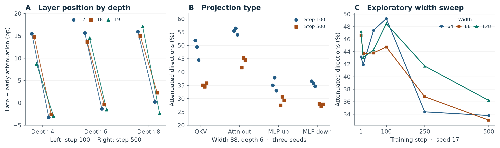
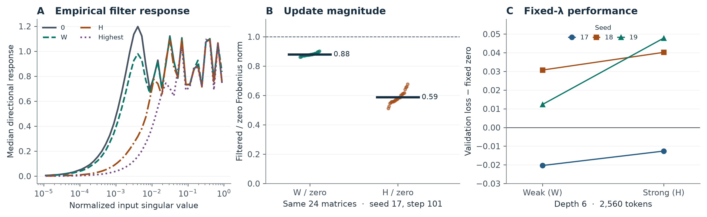
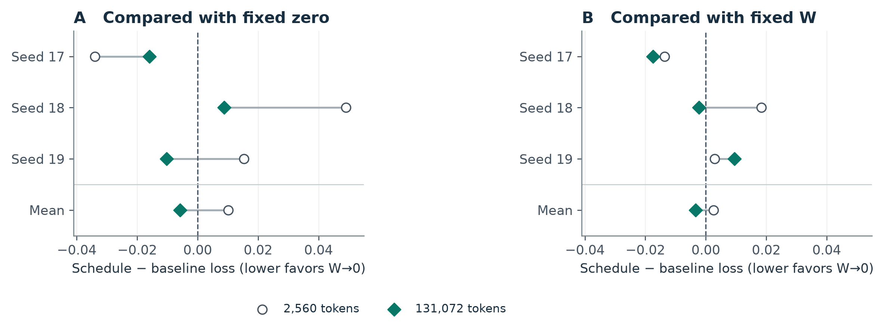

# Spectral filtering in Muon across training stages

**UC Berkeley CS 182 · Final experimental analysis**

Later transformer blocks had more attenuated update directions at step 100 in all nine depth–seed pairs. By step 500 the gap ranged from −3.3 to +2.3 percentage points. This reproducible change motivated an early-only regularization schedule. On 131,072 held-out tokens, the schedule achieved the lowest three-seed mean loss, but each seed favored a different configuration. The experiments establish when filtering behavior changes more clearly than they establish when to change the filter.

## KQ1 · Where and when does attenuation occur?

We measured the fraction of output singular values at or below 0.8, relative to the unit singular value of an exact polar update. A larger fraction means more directions fall below that reference. We computed the fraction for each filtered matrix before aspect-ratio and learning-rate scaling, weighted matrices equally, and compared the second half of the blocks with the first half. All architecture comparisons below used width 88 or depth 6 as indicated and the same five-step Gram filter with λ = 0.

| Model depth | Step 100, late − early | Step 500, late − early |
|---|---:|---:|
| 4 | +12.97 pp | −2.94 pp |
| 6 | +14.58 pp | −1.07 pp |
| 8 | +16.03 pp | +0.05 pp |

*Table 1. Equal-weight means over seeds 17–19 at width 88. The paired observations appear in Figure 1A and the [full table](depth-contrast.csv).*

**Training stage and layer position replicated.** At depth 6 the late–early gap was within half a point of zero at step 1, reached +13.6 to +15.6 points at step 100, then shrank to +5.2 to +8.8 at step 250. Every tested depth had a positive gap for every seed at step 100. The stricter 0.2 cutoff also showed a narrowing gap, from +4.4 to +6.5 points across depth means at step 100 to +0.3 to +0.5 at step 500. A small severely attenuated tail could therefore persist after the broader contrast disappeared.

**Projection type also mattered.** At width 88 and depth 6, both attention matrices had larger attenuated fractions than either feed-forward matrix in each seed at steps 100 and 500. At step 100 the attention output projection had 54–56% of directions below the threshold, versus 33–38% for the feed-forward expansion. The corresponding matrix-median normalized input singular values averaged 0.0032 and 0.0060. A fixed filter can therefore produce different outputs as the input spectrum changes.

**Width was exploratory.** At widths 64, 88 and 128, the step-100 fractions were 49.3%, 44.7% and 48.5% respectively. At step 500 they were 33.8%, 33.0% and 36.2%. All three fell, with no monotonic width ordering at either checkpoint. Widths 64 and 128 each had one seed. Changing width also changes rank and per-head dimension, and changing depth changes residual-projection initialization scale.

*Figure 1. A connects steps 100 and 500 within each seed and depth. B shows individual seeds at width 88 and depth 6. C shows the seed-17 width sweep at depth 6. The percentages in B and C are absolute fractions. Panel A shows percentage-point differences.*

**Relation to prior work.** Jordan’s Muon applies an approximate polar map to momentum. Magakyan, Parrilo and Ozdaglar observed layer- and scale-dependent momentum spectra and stabilization after burn-in in much larger models. Our contribution is the matched early-versus-late block comparison across nine small-model runs. These data cannot estimate a width scaling exponent. [Muon](https://kellerjordan.github.io/posts/muon/) · [Spectral Scaling Laws of Muon](https://arxiv.org/abs/2606.04058)

## KQ2 · Does stronger filtering improve optimization?

**The optimizer benchmarks reproduce finite-iteration filtering.** On seed 17, for normalized input singular values between 0.0009 and 0.0011, the median absolute output projections were 0.041, 0.467 and 0.836 for NS3/5/7, and 0.128, 0.821 and 0.977 for Polar Express 3/5/7. The methods used their own captured training trajectories. More iterations brought these small directions closer to the unit target. The original final losses were 6.7603, 6.7111 and 6.7262 for NS, and 6.7374, 6.7324 and 6.7371 for Polar Express. NS5 won this single-seed comparison. Amsel et al. derived faster polar approximation and reported validation gains at billion-token budgets. Our 128,000-token run reproduces the approximation behavior and supplies limited evidence about optimizer rankings. [Polar Express](https://arxiv.org/abs/2505.16932)

**Explicit regularization changed both spectral shape and total step size.** We write W for λ = 6.8851809 × 10⁻⁶ and H for λ = 6.1352038 × 10⁻⁵. These are shifts of the normalized Gram matrix, distinct from weight decay. Near normalized input singular value 0.00114, the empirical median output response fell from 0.536 at zero to 0.438 at W, 0.109 at H and 0.044 at the highest sweep value (6.83 × 10⁻⁴). Near 0.114, all four responses were between 0.716 and 0.736. This preferential suppression reproduces the MuonTikh mechanism. On identical step-101 inputs, W retained 88% of the zero-filter update norm and H retained 59%. At fixed learning rate those are also changes in parameter-step magnitude. [MuonTikh, Milsom et al.](https://edwardmilsom.github.io/blog/muon_ns_tikhonov/index.html)

| Seed | Fixed zero | Fixed W | Fixed H | W − zero | H − zero |
|---|---:|---:|---:|---:|---:|
| 17 | 6.72123 | **6.70088** | 6.70859 | −0.02035 | −0.01263 |
| 18 | **6.78797** | 6.81872 | 6.82819 | +0.03075 | +0.04021 |
| 19 | **6.84170** | 6.85403 | 6.88953 | +0.01233 | +0.04783 |

*Table 2. Fixed-filter step-500 validation loss on the original 2,560 tokens, width 88 and depth 6. Lower is better. The larger evaluation covered zero, W and the weak schedule only.*

The highest λ gave seed 17 its worst Gram-filter loss (6.75000). At depth 8 the H-minus-zero differences were +0.01636, −0.01161 and +0.01736 for seeds 17–19. Even the direction of the depth interaction changed across seeds. A transfer curve measures how strongly a direction is updated. It does not identify whether that direction carries useful signal, or whether a smaller effective step helps at the chosen learning rate. Both effects can change validation loss. The fixed-filter results consequently supply no reproducible optimal λ by depth. [Fixed-filter summary](fixed-regularization.csv)

*Figure 2. A shows median directional response in input singular-value bins on each setting’s native trajectories. B holds the input fixed and varies λ on the same seed-17 zero-prefix capture. Each point is one matrix and each bar is the mean ratio. C shows paired validation differences within each training seed.*

## KQ2/KQ3 · Does weak regularization help specifically early in training?

W→0 used W for updates 1–100 and zero for updates 101–500. On the larger held-out stream it beat both fixed configurations for seed 17. For seed 18 it beat only fixed W, by 0.00223. For seed 19 it beat only fixed zero, by 0.01027. Across the two follow-up seeds alone, its mean differences were −0.00073 versus zero and +0.00363 versus W. The discovery seed contributes disproportionately to the favorable three-seed mean.

| Seed | Fixed zero | Fixed W | W→0 | W→0 − zero | W→0 − W |
|---|---:|---:|---:|---:|---:|
| 17, discovery | 7.39495 | 7.39636 | **7.37897** | −0.01598 | −0.01739 |
| 18 | **7.40082** | 7.41186 | 7.40963 | +0.00882 | −0.00223 |
| 19 | 7.40104 | **7.38128** | 7.39078 | −0.01027 | +0.00949 |
| **Mean** | 7.39894 | 7.39650 | **7.39313** | **−0.00581** | **−0.00338** |

*Table 3. Final cross-entropy in nats per target token on the same 131,072 targets. Means weight each training seed equally. Negative differences favor the schedule. [Full precision and original losses](scheduled-validation.csv)*

*Figure 3. Each line joins evaluations of the same two final checkpoints on two different validation windows. It shows how sensitive the estimated advantage is to the sampled text.*

**Evaluation size changed the ranking.** On the original 2,560 tokens W→0 beat both baselines for seed 17 and lost to both for seeds 18 and 19. Its original mean loss was 6.79376, versus 6.78363 for zero and 6.79121 for W. The expanded window used different passages from the same held-out stream. Absolute losses rose for all nine checkpoints, and both mean paired differences reversed sign. Seed 17’s advantage persisted on the new text. Each follow-up seed now beat one baseline and lost to the other.

**Paired sequences clarify which differences are small.** The 4,096 sequences were shared across checkpoints. Within-seed standard deviations of schedule-minus-baseline sequence losses ranged from 0.090 to 0.116. Grouping adjacent sequences into 64 blocks of 2,048 tokens gives a less granular check on consistency across passages. The schedule beat zero/W in **53/51 blocks** for seed 17, **22/37** for seed 18 and **49/17** for seed 19, each out of 64. Seed 17’s win extends across much of the stream. Seed 18’s small advantage over W is close to an even split. Text sampling matters, yet opposite rankings on identical text also show that the trained checkpoints differ by seed. Adjacent blocks may share documents, and only three training seeds contribute to the mean. [Paired sequence and block statistics](../optimization-experiments/dynamic_tikh_weak_pilot/heldout_validation/paired-differences.csv)

**The switch itself produced little immediate loss disruption.** The first changed update was 101 and the first training loss it could affect was 102. On seed 17 that loss differed from the matched fixed-prefix run by −0.00003 for W→0 and +0.00002 for 0→W. The four H schedules switching after 100 or 250 likewise had first affected differences smaller than 0.0002 in magnitude. Their original final losses ranged from 6.70977 to 6.72828, all above fixed W (6.70088). For weak λ at step 100, the reverse schedule scored 6.72225 versus 6.68724 for W→0 on the original window. Even for W→0, all three seeds beat fixed W at step 300 and trailed it at step 400 on that window. The evidence favors gradual trajectory differences over an acute loss spike. The reverse weak schedule and alternative timings lack replicated comparisons, and early-only versus late-only at step 100 also changes total exposure. [Switch diagnostics](../optimization-experiments/dynamic_tikh_weak_pilot/analysis/switch-loss-summary.csv) · [Strong-λ timing pilot](../optimization-experiments/dynamic_tikh_pilot/analysis/final-results.csv) · [Per-seed validation trajectories](../optimization-experiments/dynamic_tikh_weak_pilot/replication_analysis/validation-trajectories.csv)

## Scope and next test

All schedule comparisons used the same 4.98M-parameter, width-88, six-block, eight-head language model for 500 updates, with batches of eight 32-token sequences. Muon used learning rate 0.02 and momentum 0.95 on the four projection matrices per block. AdamW used 0.003 on the remaining parameters. The Tikhonov comparisons used FP32 Gram-NS5, including their zero endpoint. Standard NS5 used BF16, so substituting it as the zero baseline would change the implementation. Matching a seed within a comparison controls initialization and training order together. Across seeds, both can vary.

All nine checkpoints shared GPT-2 tokenization and a pinned FineWeb sample-10BT revision. The deterministic evaluation used document-hash bucket 1, disjoint from training buckets 2–99. It reproduced the nine original losses within 0.000001 before scoring the next 131,072 targets. This is one additional validation window from the same corpus. The schedule was selected on seed 17 and the smaller window. Neither the number of tokens nor the number of matrices increases the number of independent training seeds. [Evaluation manifest](../optimization-experiments/dynamic_tikh_weak_pilot/heldout_validation/manifest.json)

**The most informative next comparison is norm-matched regularization.** On each matrix, rescale the weak-filter update to the Frobenius norm of its zero-filter counterpart on the same momentum input. A complementary control scales the zero-filter update down to the weak norm. Together these controls can separate an effect of direction from an effect of step magnitude. On the first switched inputs across seeds, W retained 87.9–88.9% of the zero norm, and a shape difference remained after normalizing both updates. This makes both controls relevant. [Matched-input measurements](../optimization-experiments/dynamic_tikh_weak_pilot/replication_analysis/same-input-endpoints.csv)

A candidate adaptive rule could monitor the fraction of normalized input singular values below √W, or the gap in attenuation between early and late blocks. The observed stage dependence nominates those statistics as triggers. It does not show that either predicts a benefit from switching. A prospective test would freeze the trigger and exposure budget on development runs, then compare it with fixed and step-100 norm-matched controls on fresh seeds and common held-out text. Longer training and additional evaluation windows would test whether the small mean differences persist.

**Source data for the spectral figures.** [Depth replication](../spectral-analysis/architecture_spectral_grid/analysis/depth-seed-replication.csv) · [Width grid](../spectral-analysis/architecture_spectral_grid/analysis/spectral-summary.csv) · [Operator spectra](../optimization-experiments/dynamic_tikh_weak_pilot/replication_analysis/spectral-summary.csv) · [NS and Polar Express directional responses](../spectral-analysis/layer_stage_analysis/empirical_transfer.csv) · [Tikhonov transfer curves](../optimization-experiments/muontikh_lambda_sweep/lambda-transfer-curves.csv) · [Weak and strong same-input norm ratios](../optimization-experiments/dynamic_tikh_weak_pilot/analysis/same-input-endpoints.csv)
